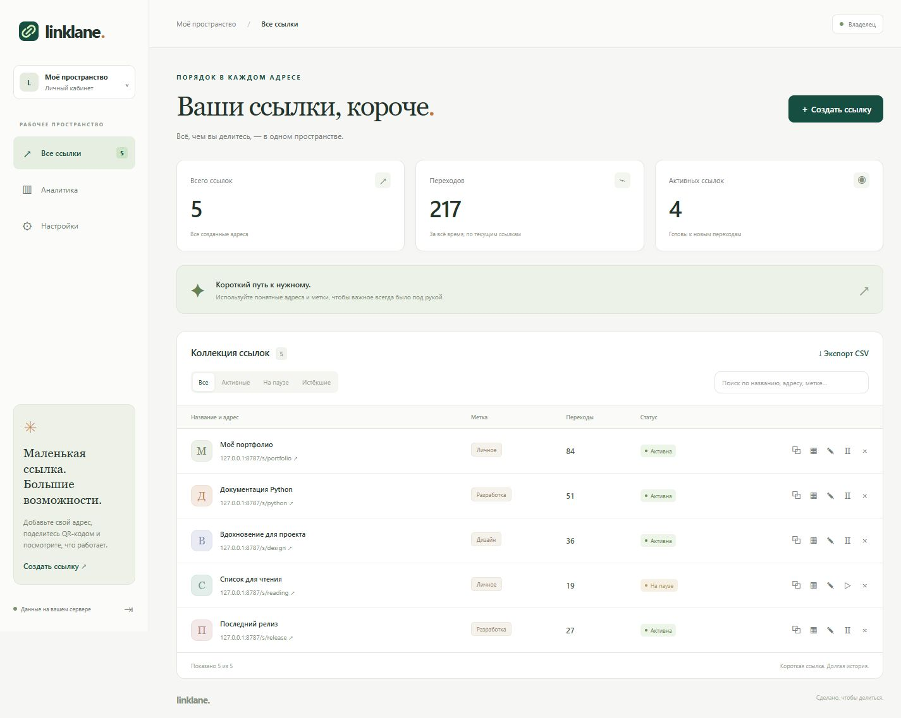
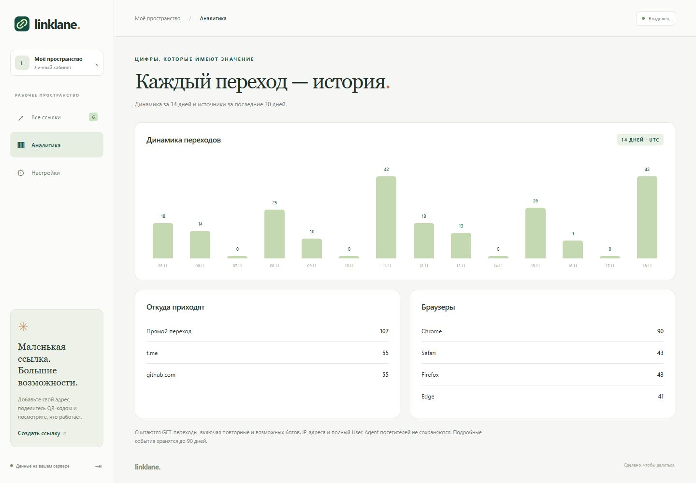
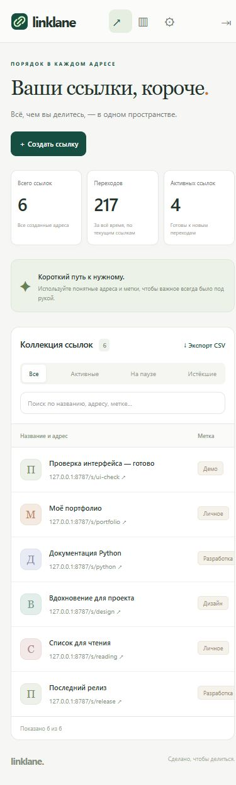

<div align="center">

# Linklane.

**Ваши ссылки, короче.**

Личный сервис коротких ссылок с QR-кодами, понятной аналитикой и кабинетом владельца.

Python 3.11+ · FastAPI · SQLite · Vanilla JS · MIT



</div>

## Возможности

- Случайные и собственные короткие адреса: `/s/my-portfolio`.
- Названия, метки, поиск, фильтры по состоянию и редактирование назначения.
- Пауза, включение, срок действия и удаление ссылок.
- Предпросмотр конечного адреса: `/p/my-portfolio`.
- QR-код каждой ссылки с выгрузкой в SVG и общий экспорт CSV.
- Счётчики переходов, график за 14 дней, источники и браузеры за 30 дней.
- Пароль владельца, закрытый API управления, защита от CSRF и ограничение попыток входа.
- Адаптивный интерфейс без внешних CDN, аналитических счётчиков и платных API.

## Быстрый запуск на Windows

Из папки проекта, при установленном Python 3.11 или новее:

```powershell
.\setup.ps1
.\start.ps1
```

Откроется `http://127.0.0.1:8787`. При первом запуске задайте пароль владельца минимум из 12 символов.
Сервер работает, пока открыто его окно терминала. Остановка — **Ctrl+C**.

Если PowerShell-скрипты отключены, используйте команды напрямую:

```powershell
py -3 -m venv .venv
.\.venv\Scripts\python.exe -m pip install -e ".[dev]"
.\.venv\Scripts\python.exe -m linklane --open
```

На этом компьютере окружение уже подготовлено. `Linklane.cmd` запускает обычный кабинет,
а `Демонстрация.cmd` — отдельный демонстрационный набор данных.

Linux / macOS:

```bash
python3 -m venv .venv
.venv/bin/python -m pip install -e '.[dev]'
.venv/bin/python -m linklane
```

## Демонстрация

```powershell
.\.venv\Scripts\python.exe -m linklane --demo --open
```

Пароль демонстрационного кабинета: **`linklane-demo-2026`**.
Это публичные тестовые данные, не рабочий пароль. Демо доступно только на loopback-интерфейсе.
Пример содержит пять ссылок и синтетическую историю из 217 переходов; реальные сайты не запрашиваются
при создании набора. Изменения в демо сохраняются в `.demo`, рабочий кабинет использует `data`.

<details>
<summary>Аналитика и мобильная версия</summary>




</details>

## Как делиться ссылками

При локальном запуске адрес `127.0.0.1` доступен только с вашего компьютера. Для внешних получателей
нужны запущенный сервер, доступный им адрес и HTTPS. Публикация исходников на GitHub сама по себе
не запускает сервер; GitHub Pages не исполняет этот Python backend.

Настройка самостоятельного размещения: [DEPLOYMENT.md](docs/DEPLOYMENT.md).

## Данные и конфигурация

| Переменная | По умолчанию | Назначение |
| --- | --- | --- |
| `LINKLANE_DATA_DIR` | `data` | Каталог SQLite и ключа сессий |
| `LINKLANE_BASE_URL` | `http://127.0.0.1:8787` | Адрес, который попадает в короткие ссылки и QR-коды |
| `LINKLANE_SECURE_COOKIES` | `0` | Для HTTPS-размещения установить `1` |

CLI также поддерживает `--port`, `--host`, `--data-dir`, `--demo`, `--open`, `--init-admin`, `--reset-password`.
`.env` автоматически не читается; переменные задаются в оболочке или через Docker Compose.
Внешний интерфейс нельзя включить через CLI без HTTPS-адреса, Secure-cookie и созданного владельца.

Восстановление забытого пароля при локальном доступе к серверу:

```powershell
.\.venv\Scripts\python.exe -m linklane --reset-password
```

Новый пароль вводится скрыто; прежние сессии перестают действовать.
Для резервной копии остановите сервер и скопируйте весь каталог данных, включая `.session-key`.
CSV — экспорт списка, а не полная резервная копия базы и статистики.

## Аналитика и приватность

Считаются GET-переходы, включая повторные обращения и возможных ботов.
HEAD и страница предпросмотра счётчик не меняют. Это число запросов, а не уникальных людей.

Для переходов сохраняются время, семейство браузера и только домен источника.
IP-адреса и полные строки User-Agent посетителей не записываются в SQLite.
События старше 90 дней удаляются при следующем переходе или просмотре аналитики;
общий счётчик действующей записи сохраняется. Удаление ссылки удаляет её статистику.
Даты графика — UTC; даты окончания в форме вводятся в локальном времени браузера.

По умолчанию Uvicorn пишет access-логи с адресом клиента в терминал.
У reverse proxy могут быть собственные журналы. Политика базы не распространяется на эти логи.

## Разработка

```powershell
.\.venv\Scripts\python.exe -m pytest -q
.\.venv\Scripts\ruff.exe check .
node --check src/linklane/static/app.js
```

Node.js нужен только для необязательной синтаксической проверки JS; для запуска сервиса он не требуется.
Тесты работают с временными базами и локальным ASGI-клиентом. Во внешние сайты они не переходят.
Снимок установленных версий — `requirements-lock.txt`; для воспроизведения среды установите его,
затем сам пакет командой `pip install -e . --no-deps --no-build-isolation`.

```text
src/linklane/
  cli.py           запуск сервера и локальное восстановление доступа
  config.py        настройки и ключ подписания cookie
  database.py      SQLite, транзакции, счётчики и аналитика
  security.py      scrypt, проверка URL, разбор источника и браузера
  web.py           страницы, сессии, CSRF и HTTP API
  demo.py          изолированные демонстрационные данные
  templates/       Jinja2-шаблоны
  static/          CSS, JavaScript и логотип SVG
tests/             сценарии API, безопасности и одновременных переходов
```

Подробности: [API](docs/API.md), [границы безопасности](SECURITY.md), [проверка выпуска](docs/QA.md).

## Разработка

Личный проект, разработанный с использованием OpenAI Codex.
Я выбрал идею, сформулировал требования к проекту и задавал направление дальнейших изменений.
Codex использовался для реализации кода, оформления интерфейса, подготовки документации и тестов.

Готовая инструкция: [публикация отдельного репозитория](docs/GITHUB.md).

Лицензия — [MIT](LICENSE). Источники API:
[FastAPI](https://fastapi.tiangolo.com/), [Starlette](https://www.starlette.io/middleware/),
[hashlib](https://docs.python.org/3/library/hashlib.html), [python-qrcode](https://github.com/lincolnloop/python-qrcode).
